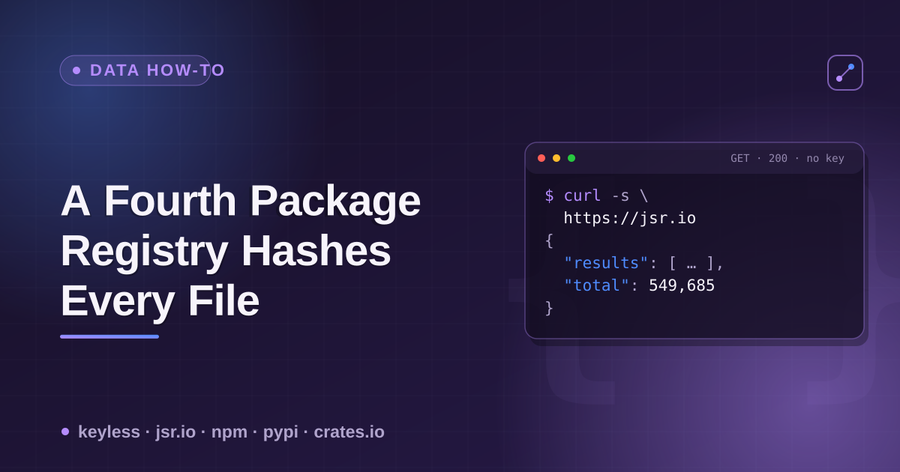

# package-file-integrity



Four registries, four different answers to "can I verify a published file is
what the maintainer actually uploaded, without fetching the whole package."
Three give you one hash for the entire download. One gives you a hash for
every individual file.

## The check, per registry

| Registry | Endpoint | What you get | Granularity |
|---|---|---|---|
| npm | `GET https://registry.npmjs.org/{name}/{version}` | `dist.integrity` (sha512), `dist.shasum` (sha1) | **Whole tarball** — one hash for everything |
| PyPI | `GET https://pypi.org/pypi/{name}/json` → `urls[]` | `digests.sha256` / `md5` / `blake2b_256` | **Per distribution artifact** — one hash per `.whl` or `.tar.gz`, still whole-file |
| crates.io | `GET https://index.crates.io/{shard}/{name}` (sparse index, one JSON line per version) | `cksum` (sha256) | **Whole crate** — one hash for the entire `.crate` |
| JSR | `GET https://jsr.io/@{scope}/{name}/{version}_meta.json` | `manifest["/path/to/file.ts"].checksum` (sha256) | **Per file** — one hash for every individual file in the package |

crates.io's shard path for a name of 4+ characters is `{first-2}/{next-2}/{name}`
(e.g. `serde` → `se/rd/serde`); 1–3 character names use shorter fixed prefixes
(`1/{name}`, `2/{name}`, `3/{first-char}/{name}`).

## Live examples (checked 2026-10-19)

```bash
# npm — one hash for the whole tarball
curl -s https://registry.npmjs.org/left-pad/1.3.0 | python3 -c \
  "import json,sys; print(json.load(sys.stdin)['dist'])"
# {'shasum': '5b8a...', 'integrity': 'sha512-XI5MPz...', 'fileCount': 10, ...}

# PyPI — one hash per distribution artifact, not per source file inside it
curl -s https://pypi.org/pypi/requests/json | python3 -c \
  "import json,sys; [print(u['filename'], u['digests']['sha256']) for u in json.load(sys.stdin)['urls']]"

# crates.io — one cksum for the whole .crate
curl -s https://index.crates.io/se/rd/serde | head -1 | python3 -c \
  "import json,sys; d=json.loads(sys.stdin.readline()); print(d['vers'], d['cksum'])"

# JSR — one checksum PER FILE
curl -s https://jsr.io/@std/path/1.1.6_meta.json | python3 -c \
  "import json,sys; m=json.load(sys.stdin)['manifest']; [print(k, v['checksum']) for k, v in list(m.items())[:3]]"
```

The JSR call is the only one of the four where you can pull a single file's
hash out of the response and verify it against a locally downloaded copy of
*just that file*, without ever fetching the rest of the package.

## Why the other three don't do this

It's not an oversight — it's a consequence of how each registry's integrity
model is scoped. npm's `integrity` field (a [Subresource Integrity](https://developer.mozilla.org/en-US/docs/Web/Security/Subresource_Integrity)-style
hash) exists to verify *the tarball download*, the same unit npm installs.
PyPI's per-artifact digests exist for the same reason, one level up — verify
the `.whl` or `.sdist` you fetched. crates.io's `cksum` is checked by `cargo`
against the downloaded `.crate` file as a whole. JSR's manifest is a
side-effect of how it builds and immutably serves packages server-side from
the individual source files it received, rather than from a maintainer-built
tarball — so a per-file manifest falls out of its publish pipeline almost for
free, where it would be extra work for the other three to retrofit.

## Mutation policy, for contrast

| Registry | Can a published version be removed/changed after the fact? |
|---|---|
| npm | Yes — unpublish within 72 hours, or anytime if no other package depends on it |
| PyPI | Yes — a maintainer can delete a release |
| crates.io | Partial — a version can be `yanked` (hidden from new installs, not deleted) |
| JSR | No, by design — per third-party write-ups (JSR's own docs page on this was unreachable at verification time), a published version is permanently immutable |

## Why this actor

[`package-registry-scraper`](https://apify.com/ponderable_hydrometer/package-registry-scraper)
normalizes npm, PyPI and crates.io into one output shape — name, version,
license, repository, dependency count, downloads — so you don't write three
different API clients to cross-reference an ecosystem. This repo is the
reference sheet for the integrity layer underneath that data: which registry
gives you what guarantee, and at what resolution.

## Related

- [`package-hallucination-check`](https://github.com/noble-ronin/package-hallucination-check) — checking whether an AI-recommended package name is real, a decoy, or a cleaned-up attack.
- Pairs with the dev.to article: [I Found a Fourth Package Registry My Sandbox Could Reach](https://dev.to/ronin13/i-found-a-fourth-package-registry-my-sandbox-could-reach-it-checksums-every-file-not-just-the-4jpf).
